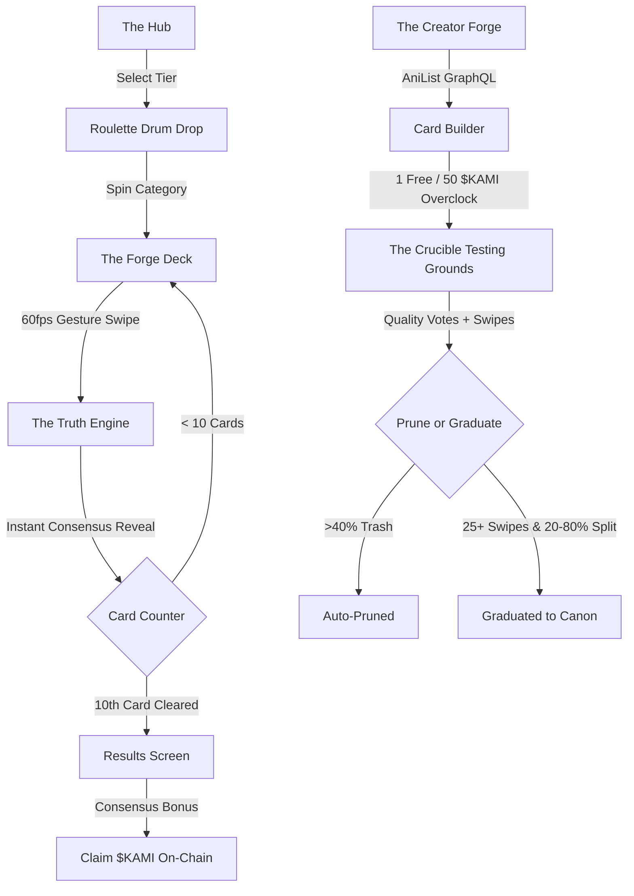

# Project Kami (神)

<div align="center">

### *Your Anime Instincts. A Whole New Way to Play.*
**Swipe. Curate. Forge. Level Up on Base.**

[](https://expo.dev)
[](https://reactnative.dev)
[](https://www.typescriptlang.org)
[](https://nativewind.dev)
[](https://sepolia.basescan.org)
[](https://privy.io)
[](https://supabase.com)
[](https://jestjs.io)

</div>

---

## 📖 Overview

**Project Kami** is an adrenaline-fueled, consensus-driven anime showdown and curation arena built for mobile. Players pit legendary characters, emotional dilemmas, and iconic matchups head-to-head across 10-card curated decks—aligning with the community majority or betting on their rebel instincts to earn on-chain **$KAMI** rewards.

With **The Creator Forge**, players transcend from mere curators into **Master Architects**, submitting their own high-stakes anime debates directly into **The Crucible** testing grounds through live AniList GraphQL integration, community quality voting, and dynamic canon graduation.

---

## ⚡ Smart Contract & Token Details (Base Sepolia)

The **$KAMI** token is a fixed-supply ERC-20 deployed on Base Sepolia with built-in Role-Based Access Control (RBAC), daily distribution limits, and native support for gasless Smart Wallet operations.

| Parameter | Specification | Details / On-Chain Link |
| :--- | :--- | :--- |
| **Token Name** | Project Kami | Fixed Supply ERC-20 |
| **Token Symbol** | **$KAMI** | 18 Decimals |
| **Network** | **Base Sepolia Testnet** | Layer 2 Ethereum Testnet |
| **Chain ID** | `84532` | Hex: `0x14a34` |
| **Contract Address** | [`0xb7dE9b14742C3dbf3d4e3af83aF026Bf4CB6A9c6`](https://sepolia.basescan.org/token/0xb7dE9b14742C3dbf3d4e3af83aF026Bf4CB6A9c6) | Verified on BaseScan |
| **Deployment Tx** | [`0x983cc407e97...`](https://sepolia.basescan.org/tx/0x983cc407e97fb991afcc265d507376d12a418a01152d0ca6c7fa71bff1c32285) | Block: `48130470` |
| **Total Supply** | `1,000,000,000 KAMI` | 1 Billion $KAMI (Hard Cap) |
| **Rewards Vault** | `400,000,000 KAMI` (40%) | Contract-held game rewards pool |
| **Treasury / Team / Liquidity** | `600,000,000 KAMI` (20% each) | Ecosystem expansion & dev funds |
| **Admin Wallet** | `0x92C0Ff120BbB831E8089dfEF6Add8bb7e0695A98` | Multi-sig deployment authority |
| **Distributor Wallet** | `0xFd57B378806519369deC5Efd12172B16547eDeca` | Gasless automated claim relayer |
| **Daily Distribution Cap** | `500,000 KAMI` per UTC day | In-circuit anti-drain throttle |

---

## 🎮 Core Architecture & Gameplay Loops



### 1. The Hub & Tier Multipliers (`HubScreen.tsx`)
* Players select between 3 escalating difficulty tiers:
  * **Tier 1: Shonen Jump** (1.0x Multiplier) — Universal mainstream battles.
  * **Tier 2: Cult Classic** (1.5x Multiplier) — Deep cuts and nuanced thematic face-offs.
  * **Tier 3: Arch-Sage** (3.0x Multiplier) — Complex philosophical and technical debates.
* Integrated with **Privy Embedded Wallets** displaying live on-chain balances, avatars, and streak indicators.

### 2. The Roulette Drop (`RouletteModal.tsx`)
* Vertical slot-machine drum animation driven by Reanimated physics with custom deceleration curves.
* Dynamically cycles across 8 official categories:
  * ⚔️ **Genre Clash**
  * 🎵 **OST & Sound Design**
  * 🛡️ **Plot Armor**
  * 🏢 **Studio vs. Studio**
  * 📖 **The Adaptation Test**
  * 🌌 **Verse vs. Verse**
  * 💀 **Villain Justification**
  * 💖 **Waifu Wars**
* Provides tactile haptic feedback ticks on cycle transitions and locking states.

### 3. The Forge Deck & Ambient Visual Engine (`SwipeCard.tsx`)
* 60fps UI-thread gesture card deck powered by `react-native-gesture-handler` and `react-native-reanimated`.
* **Triple-Layer Presentation Engine**:
  1. **Ambient Blurred Backdrop**: Uses `blurRadius={12}` to fill letterbox margins with a soft aura of the anime artwork.
  2. **Contrast Scrim**: Deep slate overlay (`rgba(15, 23, 42, 0.55)`) ensuring text badges and stamps maintain strong contrast.
  3. **100% Fitted High-Resolution Poster**: Centered portrait key visual (`coverImage`) filling 100% of the container height with zero stretching and zero cropping.

### 4. The Truth Engine (`useTruthEngine.ts` & Supabase RPC)
* Real-time calculation of community consensus upon every swipe.
* **The 800ms Flash Reveal**:
  * 🟢 **Majority Match**: Emerald glowing stamp (*"82% Agreed! — You matched the community majority!"*).
  * 🟠 **Rebel Instinct**: Warm Mango stamp (*"68% Disagreed — Rebel instinct logged against the crowd!"*).

### 5. Results & On-Chain Settlement (`ResultsScreen.tsx` & `TransferScreen.tsx`)
* **Consensus Bonus**: Dynamic multiplier reward based on player consensus rate:
  $$\text{Total Reward} = \text{Base (0.5 } \$KAMI\text{)} \times \text{Consensus Bonus} \times \text{Tier Multiplier}$$
* Gasless transfers executed on Base Sepolia using Privy embedded smart wallets.

---

## 🔨 The Creator Forge & Hybrid Crucible Pipeline

The Creator Forge empowers players to architect their own Hot Takes and inject them directly into the community arena.

```
   [ AniList GraphQL ] ──> Auto-fetch Cover Art & Popularity
            │
   [ Creator Forge ] ──> 1 Free Daily / 50 $KAMI Overclock
            │
   [ The Crucible ]  ──> Dedicated Arena or Card #10 Injection
            │
   ┌────────┴────────┐
   ▼                 ▼
[ 🔥 Fire ]       [ 🗑️ Trash ]
(Quality Upvote)  (Flag Quality Issue)
```

### Guardrails & Automated Routing
1. **AniList GraphQL Search**: Debounced autocomplete with minimum 2 characters. Automatically resolves official English/Romaji titles, popularity metrics, and high-definition portrait cover art.
2. **Deterministic Tier Routing**:
   $$\text{Mean Popularity} = \frac{\text{Popularity}_A + \text{Popularity}_B}{2}$$
   * $> 300,000 \rightarrow$ **Tier 1 (Shonen Jump)**
   * $50,000 - 300,000 \rightarrow$ **Tier 2 (Cult Classic)**
   * $< 50,000 \rightarrow$ **Tier 3 (Arch-Sage)**
3. **Anti-Spam Tokenomics**:
   * **1 Free Forge per 24 hours** tracked via `last_free_forge_at`.
   * **50 $KAMI Overclock** fee deducted for additional submissions on the same calendar day.
4. **Anti-Spam Unique Impressions**:
   * Dedicated `community_prompt_votes` ledger enforces **1 vote per user per community prompt**. Subsequent swipes by the same account do not inflate counters.
5. **Quality Voting & Crucible Lifecycle**:
   * Players swipe on the debate (Left/Right) while simultaneously rating prompt quality (`🔥 Fire` vs `🗑️ Trash`).
   * **Auto-Pruning**: Prompts exceeding 40% negative ratio with 3+ trash flags are automatically archived.
   * **Canon Graduation**: Prompts accumulating 25+ swipes with balanced debate split (20% - 80%) graduate to permanent Canon status.

---

## 🏆 Global Leaderboards & Scoring Mechanics

The Leaderboard features dual competitive ladders:

### 1. Top Curators
Ranked by the deterministic **Composite Curator Score** with cascading tie-breakers:
$$\text{Curator Score} = \lfloor\text{lifetime\_earned\_kami} \times 100\rfloor + (\text{total\_swipes} \times 10) + (\text{current\_streak} \times 25)$$

* **Ordering Priority**: `curator_score DESC`, `lifetime_earned_kami DESC`, `total_swipes DESC`, `created_at ASC`.
* Prevents penalizing players for spending $KAMI in the Cosmetics Shop.

### 2. Master Architects
Ranked by community creation impact:
* **Metric**: Total creator swipes received (`creator_swipes_received`) and quality upvotes earned.

---

## 🛠️ Technology Stack

| Domain | Technology | Version | Purpose |
| :--- | :--- | :--- | :--- |
| **Framework** | [Expo SDK](https://expo.dev) | `~57.0.27` | Universal React Native development platform |
| **Runtime** | React Native | `0.86.3` | Native Android & iOS engine |
| **Language** | TypeScript | `~6.0.3` | End-to-end strict type safety |
| **Styling** | NativeWind / Tailwind | `^4.2.7` | Utility-first responsive CSS styling |
| **Animations** | Reanimated | `4.5.1` | Native thread 60fps gestures and physics |
| **Gestures** | Gesture Handler | `~2.32.0` | Pan, swipe, and multi-touch recognition |
| **Web3 / Auth** | Privy Expo SDK | `^0.76.0` | Embedded smart wallets & social authentication |
| **EVM Client** | Viem | `^2.57.3` | Base Sepolia RPC contract interactions |
| **Backend & DB** | Supabase | `^2.109.0` | PostgreSQL, Row Level Security & RPC functions |
| **Anime Data** | AniList APIv2 | GraphQL | Media search, cover images & popularity scores |
| **Testing** | Jest & Testing Library | `~29.7.0` | 14 test suites, 63 unit & integration tests |

---

## 📂 Project Structure

```
Project-Kami/
├── contracts/                        # Foundry Solidity smart contract project
│   ├── src/                          # KamiToken.sol ERC-20 contract
│   ├── script/                       # Deployment scripts
│   └── test/                         # Foundry fuzz & unit tests
├── mobile/
│   ├── .agent/                       # Technical directives & architecture specs
│   └── kami-mobile/                  # Main Expo React Native application
│       ├── assets/
│       │   └── categories/
│       │       └── tier_01/          # 8 sanitized category prompt decks (JSON)
│       ├── scripts/
│       │   ├── hydrate_anime_images.mjs  # AniList sync & cover image pipeline
│       │   └── credit-smart-wallet.sh    # Base Sepolia faucet script
│       ├── src/
│       │   ├── components/
│       │   │   ├── HubHeader.tsx     # Wallet balance, avatar & streak status
│       │   │   ├── KamiLogo.tsx      # SVG brand identity
│       │   │   ├── RouletteModal.tsx # Dynamic slot drum category selector
│       │   │   └── SwipeCard.tsx     # Ambient blur + fitted poster swipe card
│       │   ├── data/
│       │   │   ├── PromptRegistry.ts     # Category metadata & Fisher-Yates shuffle
│       │   │   └── anime_media_cache.json # Cached AniList media records
│       │   ├── hooks/
│       │   │   ├── useKamiBalance.ts # Real-time on-chain token balance hook
│       │   │   ├── useKamiWallet.ts  # Privy smart wallet provider
│       │   │   └── useTruthEngine.ts # Consensus & swipe submission hook
│       │   ├── lib/
│       │   │   └── supabase.ts       # Supabase client with RLS headers
│       │   ├── navigation/
│       │   │   ├── MainTabNavigator.tsx  # Hub, Leaderboard, Shop bottom tabs
│       │   │   └── RootNavigator.tsx     # Full stack navigator
│       │   ├── screens/
│       │   │   ├── ForgeCreateScreen.tsx # Creator Forge card builder
│       │   │   ├── ForgeScreen.tsx       # 10-card arena & The Crucible
│       │   │   ├── HubScreen.tsx         # Difficulty selector & hub dashboard
│       │   │   ├── LeaderboardScreen.tsx # Top Curators & Master Architects
│       │   │   ├── LoginScreen.tsx       # Privy social & email onboarding
│       │   │   ├── ProfileScreen.tsx     # Curator Passport & forged cards
│       │   │   ├── ResultsScreen.tsx     # Reward breakdown & consensus claim
│       │   │   ├── ShopScreen.tsx        # Avatar borders & cosmetics shop
│       │   │   └── TransferScreen.tsx    # Gasless $KAMI on-chain transfers
│       │   └── types/
│       │       ├── database.ts       # Supabase table definitions & RPC types
│       │       └── forge.ts          # Prompt, Tier, and Category interfaces
│       ├── supabase/
│       │   └── schema.sql            # PostgreSQL schema, views & RPC functions
│       ├── App.tsx                   # Privy & SafeArea root entry point
│       ├── app.json                  # Expo configuration
│       └── package.json
└── README.md
```

---

## ⚙️ Environment Configuration

Create a `.env` file in `mobile/kami-mobile/`:

```env
# Privy Authentication & Embedded Wallets
EXPO_PUBLIC_PRIVY_APP_ID=your_privy_app_id
EXPO_PUBLIC_PRIVY_CLIENT_ID=your_privy_client_id

# Supabase Backend
EXPO_PUBLIC_SUPABASE_URL=https://your-project.supabase.co
EXPO_PUBLIC_SUPABASE_ANON_KEY=your_supabase_anon_key

# Smart Contracts (Base Sepolia)
EXPO_PUBLIC_KAMI_TOKEN_ADDRESS=0xb7dE9b14742C3dbf3d4e3af83aF026Bf4CB6A9c6
```

---

## 🚀 Getting Started

### 1. Prerequisites
* **Node.js**: v18+ or v20+
* **JDK**: OpenJDK 17
* **Android SDK**: Build-tools 35.0.0+, Android Platform 35
* **Privy & Supabase Accounts**

### 2. Install Dependencies
```bash
cd mobile/kami-mobile
npm install
```

### 3. Start Development Server
```bash
# Standard Expo Metro Bundler
npx expo start

# Android Native Dev Build (with native access flag)
JAVA_TOOL_OPTIONS="--enable-native-access=ALL-UNNAMED" npx expo run:android -d
```

### 4. Run Verification Suite
```bash
# Run unit & integration tests (14 test suites, 63 tests)
npm test

# Run strict TypeScript compiler verification
npx tsc --noEmit
```

---

## 🗄️ Database Setup (Supabase)

To provision the Truth Engine, Creator Forge, and Leaderboard RPCs:
1. Open the [Supabase Dashboard](https://supabase.com/dashboard).
2. Navigate to **SQL Editor > New Query**.
3. Execute the SQL script located in:
   [`mobile/kami-mobile/supabase/schema.sql`](mobile/kami-mobile/supabase/schema.sql)

### Essential RPC Functions Included:
* `record_swipe(p_user_id, p_prompt_id, p_swipe_direction)`: Atomically logs swipe and calculates consensus.
* `record_community_swipe_and_quality(p_user_id, p_prompt_id, p_swipe_direction, p_quality_vote)`: Logs community swipe with anti-spam unique impression verification.
* `submit_community_prompt(...)`: Enforces 24-hour free cooldown or charges 50 $KAMI overclock fee.
* `curator_leaderboard`: Real-time window view computing Composite Curator Score and global ranks.

---

## 📄 License

This repository is licensed under the **MIT License**. See [LICENSE](LICENSE) for details.

<div align="center">
<sub>Crafted with passion by the Project Kami Team. Built for anime culture on Base.</sub>
</div>
